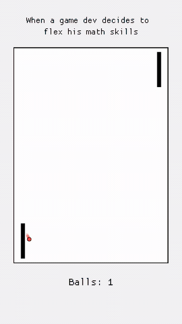

# Pong Math Simulation

A small Rust + Macroquad artwork that turns Pong into a self-sustaining mathematical system. Two paddles move in a shared oscillation cycle while colorful balls reflect between the arena walls, creating branching motion patterns as each impact generates new trajectories.



## Overview

This project creates a stylized Pong-like simulation where:

- both paddles sweep vertically in a synchronized anti-phase rhythm
- the ball update loop runs at a fixed 120 Hz
- each paddle hit chooses a new wall-targeted trajectory
- companion balls can split off from a collision, creating a growing field of paths
- the simulation is capped at 3,000 balls to keep the scene stable

## Requirements

- Rust toolchain with Cargo
- a desktop environment capable of running a Macroquad window

## Run

From the project directory:

```sh
cargo run --release
```

To build without launching the app:

```sh
cargo build --release
```

To re-record the demo animation (requires `ffmpeg`):

```sh
cargo run --release --example record_gif
```

## Controls

- `R`: reset the simulation to its initial state
- `Esc`: close the window

## Simulation details

- The paddles share a single oscillation period and remain offset by 180 degrees.
- Trajectories are chosen to cover a wide range of wall-hit positions instead of repeating a narrow pattern.
- A quasi-random target sequence helps the motion spread evenly across the arena.
- Resetting restores the first ball and clears the active branching system.

## Project info

- Language: Rust
- Graphics library: Macroquad
- Window size: 540 x 960
- Fixed step: 1/120 seconds